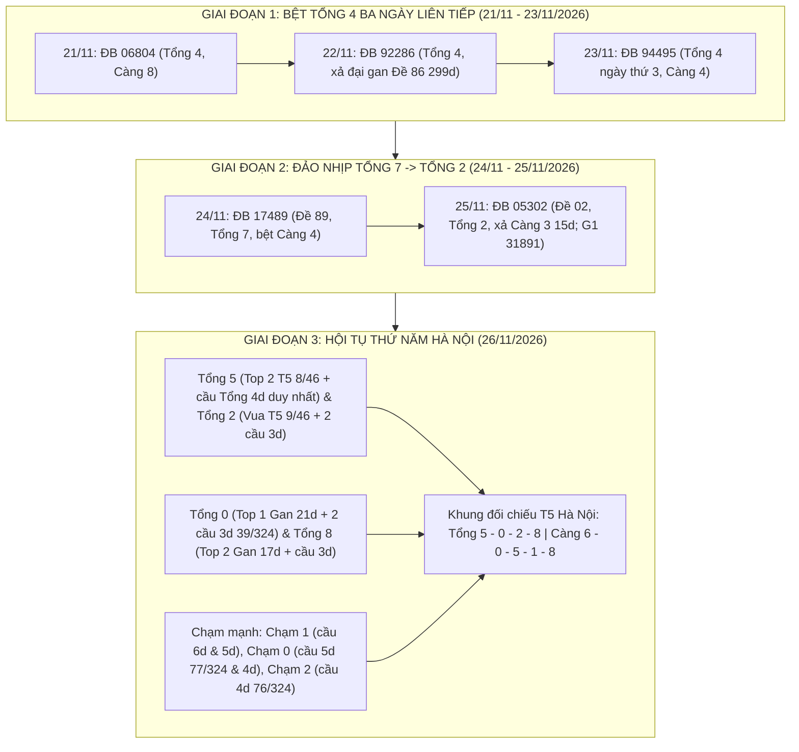

# BẢN ĐỒ TOÀN BỘ MA TRẬN TỔNG ĐẶC BIỆT & SƠ ĐỒ TỔNG THỂ SỰ KIỆN TRÙNG HỢP
### *Cơ sở dữ liệu: 36 tuần (23/03 – 25/11/2026) | 325 kỳ quay 2026 & 4.638 kỳ quay lịch sử 13 năm (2014 – 2026)*

---

## 1. TOÀN BỘ MA TRẬN 36 TUẦN TỔNG ĐẶC BIỆT (2026)

Bảng dưới đây thống kê **chữ số Tổng Đề (hàng chục + hàng đơn vị của Giải Đặc Biệt mod 10)** qua 36 tuần liên tục:

| Tuần | Khoảng thời gian | T2 | T3 | T4 | T5 | T6 | T7 | CN | Ghi chú hình thế Tổng |
| :---: | :---: | :---: | :---: | :---: | :---: | :---: | :---: | :---: | :--- |
| **01** | 23/03 – 29/03 | 5 | 1 | 6 | 2 | 5 | 4 | 6 | Khởi đầu chu kỳ |
| **02** | 30/03 – 05/04 | 0 | 0 | 2 | 3 | 8 | 0 | 0 | 4 góc số 0 |
| **03** | 06/04 – 12/04 | 6 | 0 | 5 | 7 | 2 | 4 | 0 | |
| **04** | 13/04 – 19/04 | 1 | 9 | 5 | 8 | 0 | 7 | 7 | |
| **05** | 20/04 – 26/04 | 6 | 3 | 2 | 2 | 3 | 8 | 0 | |
| **06** | 27/04 – 03/05 | 4 | 9 | 5 | 2 | 0 | 5 | 0 | |
| **07** | 04/05 – 10/05 | 6 | 3 | 5 | 4 | 1 | 1 | 5 | |
| **08** | 11/05 – 17/05 | 8 | 6 | 1 | 5 | 3 | 4 | 2 | |
| **09** | 18/05 – 24/05 | 7 | 9 | 4 | 3 | 2 | 3 | 4 | |
| **10** | 25/05 – 31/05 | 9 | 2 | 4 | 5 | 9 | 7 | 6 | Bắt đầu bằng 9 |
| **11** | 01/06 – 07/06 | 8 | 5 | 9 | 1 | 5 | 1 | 2 | |
| **12** | 08/06 – 14/06 | 5 | 6 | 8 | 1 | 7 | 5 | 0 | |
| **13** | 15/06 – 21/06 | 8 | 2 | 3 | 5 | 0 | 6 | 1 | |
| **14** | 22/06 – 28/06 | 9 | 0 | 6 | 7 | 4 | 8 | 7 | Bắt đầu bằng 9 |
| **15** | 29/06 – 05/07 | 6 | 4 | 9 | 2 | 1 | 5 | 8 | |
| **16** | 06/07 – 12/07 | 6 | 6 | 7 | 3 | 3 | 1 | 3 | Kép 6-6 đầu tuần |
| **17** | 13/07 – 19/07 | 8 | 1 | 0 | 9 | 2 | 9 | 1 | |
| **18** | 20/07 – 26/07 | 0 | 7 | 9 | 9 | 1 | 0 | 7 | |
| **19** | 27/07 – 02/08 | 5 | 0 | 1 | 7 | 1 | 5 | 9 | |
| **20** | 03/08 – 09/08 | 1 | 7 | 6 | 3 | 6 | 4 | 3 | |
| **21** | 10/08 – 16/08 | 2 | 0 | 8 | 8 | 9 | 5 | 5 | |
| **22** | 17/08 – 23/08 | 2 | 1 | 7 | 5 | 6 | 4 | 1 | |
| **23** | 24/08 – 30/08 | 8 | 8 | 7 | 9 | 4 | 0 | 9 | Kép 8-8 đầu tuần |
| **24** | 31/08 – 06/09 | 8 | 3 | 6 | 2 | 2 | 0 | 8 | |
| **25** | 07/09 – 13/09 | 9 | 5 | 4 | 9 | 7 | 6 | 8 | Bắt đầu bằng 9 |
| **26** | 14/09 – 20/09 | 4 | 1 | 8 | 6 | 3 | 3 | 1 | |
| **27** | 21/09 – 27/09 | 5 | 4 | 6 | 5 | 1 | 5 | 0 | |
| **28** | 28/09 – 04/10 | **6** | **6** | **6** | 8 | 1 | 7 | 6 | **Tam hoa 6 đầu tuần (6-6-6)** |
| **29** | 05/10 – 11/10 | **9** | **9** | **6** | 2 | 8 | 8 | 9 | Đoạn mã [9 - 9 - 6] |
| **30** | 12/10 – 18/10 | 5 | **9** | 4 | 2 | 1 | 1 | 6 | |
| **31** | 19/10 – 25/10 | **9** | **9** | **9** | 5 | 3 | 5 | 0 | **Tam hoa 9 đầu tuần (9-9-9)** |
| **32** | 26/10 – 01/11 | 3 | 0 | 2 | 1 | 4 | 2 | 8 | Chuyển dịch nhịp chẵn |
| **33** | 02/11 – 08/11 | **1** | **0** | **0** | 2 | 4 | 5 | 8 | **Kép Tổng [0 - 0] (Đề 46-46 bệt đúp)** |
| **34** | 09/11 – 15/11 | **9** | **1** | **1** | **9** | **6** | **2** | **7** | Xả Tổng 6 (`25d`) & Tổng 7 (`42d` via Đề `25`) |
| **35** | 16/11 – 22/11 | **3** | **1** | **6** | **5** | **6** | **4** | **4** | Bệt Tổng `[4 - 4]` cuối tuần (`04 -> 86` xả đại gan `299d`) |
| **36** | 23/11 – 29/11 | **4** | **7** | **2** | **[ ? ]** | | | | **T2 bệt Tổng 4 (`95`), T3 Tổng 7 (`89`), T4 Tổng 2 (`02`); Hôm nay: T5 — Hà Nội** |

---

## 2. SƠ ĐỒ DÒNG CHẢY GIẢI PHÓNG CÁC CHUỖI GAN & TÍN HIỆU THỰC CHỨNG

---

## 3. BẢNG THỐNG KÊ GAN TỔNG HIỆN TẠI (TÍNH ĐẾN 25/11/2026)

| Thứ hạng | Chữ số Tổng Đề | Số ngày chưa về (Mức Gan) | Kỷ lục Max 13 năm | Lần gần nhất xuất hiện | Trạng thái kỹ thuật |
| :---: | :---: | :---: | :---: | :---: | :--- |
| 🥇 **TOP 1** | **Tổng 0** | **21 ngày** | 67 ngày (2025) | Ngày 04/11/2026 (ĐB `53046`) | **Gan cao nhất hiện tại + Sở hữu `2` cầu Tổng `3d` (`39/324`)** |
| 🥈 **TOP 2** | **Tổng 8** | **17 ngày** | 59 ngày (2016) | Ngày 08/11/2026 (ĐB `38926`) | **Gan Top 2 + Có cầu Tổng `3d` (`32/324`) + `5/46` Thứ Năm** |
| 🥉 **TOP 3** | **Tổng 9** | **13 ngày** | 53 ngày (2023) | Ngày 12/11/2026 (ĐB `43454`) | Đồng Top 3 Thứ Năm Hà Nội (`6/46`) |
| 4 | **Tổng 3** | **9 ngày** | 67 ngày (2021) | Ngày 16/11/2026 (ĐB `97403`) | Nhịp trung bình Thứ Năm (`4/46`) |
| 5 | **Tổng 1** | **8 ngày** | 63 ngày (2021) | Ngày 17/11/2026 (ĐB `29865`) | Nhịp nhẹ Thứ Năm (`3/46`) |
| 6 | **Tổng 5** | **6 ngày** | 58 ngày (2018) | Ngày 19/11/2026 (ĐB `15178`) | **Top 2 Thứ Năm (`8/46`) + Cầu Tổng thông `4d` duy nhất `(G2.1[4]+ĐB[1])%10`** |
| 7 | **Tổng 6** | **5 ngày** | 66 ngày (2015) | Ngày 20/11/2026 (ĐB `10760`) | Ít về Thứ Năm (`2/46`) |
| 8 | **Tổng 4** | **2 ngày** | 56 ngày (2016) | Ngày 23/11/2026 (ĐB `94495`) | Đồng Top 3 Thứ Năm (`6/46`), vừa bệt 3 ngày (`21–23/11`) |
| 9 | **Tổng 7** | **1 ngày** | 58 ngày (2025) | Ngày 24/11/2026 (ĐB `17489`) | Nhịp nhẹ Thứ Năm (`3/46`) |
| 10 | **Tổng 2** | **0 ngày** | 64 ngày (2014–2015) | Ngày 25/11/2026 (ĐB `05302`) | Vừa nổ Thứ Tư (`25/11`: Đề `02`), nhưng là **Vua Tổng Thứ Năm (`9/46`) + `2` cầu `3d`** |

---

## 4. GIẢI MÃ TRỤC TỔNG CHO THỨ NĂM (26/11/2026 — ĐÀI HÀ NỘI)

Sau khi Thứ Tư Bắc Ninh (`25/11`) nổ Đề **`02`** (Tổng `2`, Càng `3`), mạch tuần `48` chuyển sang đài Hà Nội Thứ Năm:
$$\text{T2 (T4: 95)}\ \longrightarrow\ \text{T3 (T7: 89)}\ \longrightarrow\ \text{T4 (T2: 02)}\ \longrightarrow\ \text{T5 Tuần 48 (Hà Nội [ ? ])}$$

### 🎯 Trục #1: Cầu Thông Dài Nhất & Nhóm Vua Đài Thứ Năm $\rightarrow$ **TỔNG 5** (`8/46`, cầu `4d`) & **TỔNG 2** (`9/46`, `2` cầu `3d`)
* **Tổng `5`** giữ Top 2 tần suất Thứ Năm Hà Nội (`8/46`, `17.4%`) và sở hữu **cầu Tổng thông `4d` duy nhất** `(G2.1[4]+ĐB[1])%10` (`33/324`).
* **Tổng `2`** vừa nổ ngày `25/11` (`02`) nhưng vẫn là **Vua Tổng Thứ Năm (`9/46`, `19.6%`)** kèm **2 cầu Tổng `3d`** (`37/324` & `34/324`), cần lưu ý kịch bản bệt Tổng.

### 🎯 Trục #2: Nhóm Tổng Gan Sâu Có Cầu Hỗ Trợ $\rightarrow$ **TỔNG 0** (`21d`, `2` cầu `3d`) & **TỔNG 8** (`17d`, cầu `3d`)
* **Tổng `0`** gan cao nhất toàn bảng (`21` ngày) và hội tụ **2 cầu Tổng `3d`** cùng đạt hiệu suất cao nhất nhóm (`39/324`, `12.0%`).
* **Tổng `8`** đang gan Top 2 (`17` ngày), có `5/46` kỳ Thứ Năm và 1 cầu `3d` hỗ trợ `(G2.2[2]+G3.4[4])%10`.
* **Lưu ý Chạm:** Cầu Chạm nổi bật nhất sau `25/11` là **Chạm `1`** (cầu thông `6d` `(G2.2[2]+G7.4[0])%10` + cầu `5d`), **Chạm `0`** (cầu `5d` `77/324` + cầu `4d`) và **Chạm `2`** (cầu `4d` `76/324` + cầu 1 vị trí `G3.5[4]` `11/30d`); cùng lúc **Đầu `3` (`32d`)**, **Đầu `4` (`21d`)** và **Đuôi `7` (`19d`)** tiếp tục là 3 trục Đầu/Đuôi gan lâu nhất.
